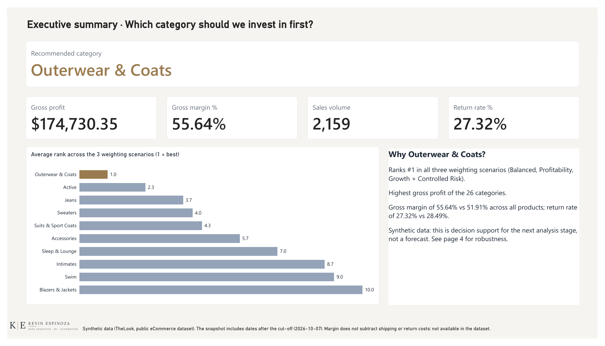

# E-commerce Marketing Decision Analytics

**Where should a growing e-commerce business with a limited marketing budget focus next?**

This project builds an end-to-end decision-support system for a **fictional** e-commerce company whose sales are growing more slowly than expected. Instead of spending more across the board, the company needs evidence on which product categories are truly profitable, which carry operational risk (returns, cancellations), and where marketing effort is most likely to pay off.

> **Data note:** the analysis uses the public [TheLook eCommerce](https://console.cloud.google.com/marketplace/product/bigquery-public-data/thelook-ecommerce) dataset on Google BigQuery, which is **synthetic**. All figures describe this dataset only, never a real company.

## Project Progress

| Stage | Focus | Status |
|---|---|---|
| 0 | Environment and repository setup | ✅ Completed |
| 1 | Business case and dataset selection ([docs](docs/stage-01-business-case.md)) | ✅ Completed |
| 2 | Data preparation and analytical validation in SQL / BigQuery ([docs](docs/stage-02-data-preparation.md), [SQL](sql/)) | ✅ Completed |
| 3 | Data model, DAX measures and Power BI dashboard ([docs](docs/stage-03-data-model.md)) | ✅ Completed |
| 4 | Star products inside the winning category (Outerwear & Coats) | Planned |
| 5 | Marketing and creative decisions for the top products (assumption-based, because TheLook has no marketing data) | Planned |
| 6 | n8n automation and AI-assisted content generation, with human review before publishing | Planned |
| 7 | Publication, performance metrics and feedback loop | Planned |
| 8 | Portfolio finalization | Planned |

Stages 4 to 8 are planned and may be refined as each stage begins.



*Stage 3 Power BI dashboard — Executive summary page (frozen snapshot 2026-10-07; synthetic data).*

Other dashboard pages:

- [Model validation](powerbi/01-model-validation.png)
- [Category decision](powerbi/03-category-decision.png)
- [Robustness & limitations](powerbi/04-robustness-limitations.png)

**Stage 2 highlights:** referential-integrity and date-consistency checks, documented revenue and COGS recognition rules by order status, monthly MoM/YoY performance, and a multi-dimensional Category Decision Model (Min-Max scoring plus sensitivity and robustness analysis).

## Technologies

- **[n8n](https://n8n.io/)** — low-code workflow automation platform (core tool of this repository)
- **APIs** — REST/webhook integrations with third-party services
- **AI agents / LLMs** — AI-powered nodes and agent-based automation workflows
- **JSON** — n8n workflows are exported and version-controlled as JSON files
- Additional tools and integrations will be added as the projects grow in complexity

## Folder Structure

```
.
├── workflows/               # n8n workflow JSON exports
│   ├── 01-learning/         # Tutorial and practice workflows
│   ├── 02-personal-projects/# Independent, self-directed automations
│   └── 03-portfolio-projects/ # Polished, portfolio-ready automations
├── docs/                    # Notes, guides, and project documentation
│   ├── stage-01-business-case.md
│   ├── stage-02-data-preparation.md
│   └── stage-03-data-model.md
├── sql/                     # SQL scripts (added in Stage 2 — see below)
├── data/
│   └── raw/                 # Frozen dataset snapshots (added in Stage 3 — see below)
├── scripts/                 # Python scripts (added in Stage 3 — see below)
├── powerbi/                 # Power BI dashboard screenshots (added in Stage 3);
│                            # the .pbix and .pbit stay outside the repository
├── templates/                # Reusable workflow templates and boilerplates
├── .gitignore
└── README.md
```

### `workflows/`

This is where exported n8n workflow JSON files live, organized by maturity:

- **`01-learning/`** — workflows built while following tutorials or experimenting with new nodes/concepts.
- **`02-personal-projects/`** — self-directed automations built to solve real, personal problems.
- **`03-portfolio-projects/`** — finished, documented, portfolio-ready automation projects.

### `docs/`

Reference notes, setup guides, architecture explanations, and any written documentation that supports the workflows in this repository. This includes one documentation/log file per stage (see "Development Approach" below): `stage-01-business-case.md`, `stage-02-data-preparation.md`, and `stage-03-data-model.md`.

### `sql/`

Added in Stage 2. Contains the project's SQL scripts — currently BigQuery SQL written against the `bigquery-public-data.thelook_ecommerce` public dataset, used for data-quality validation and analysis (Project 01, Stage 2 — Data Preparation & Analytical Validation):

- `01_data_quality_validation.sql` — referential integrity, order-item-count consistency, status/date consistency, chronological validation.
- `02_financial_validation.sql` — sale price and inventory cost validation, financial recognition rules, financial baseline.
- `03_monthly_performance_analysis.sql` — monthly financial aggregation, MoM/YoY growth, profitability trend.
- `04_category_performance_analysis.sql` — category financial/operational performance, Min-Max normalization, multi-scenario sensitivity analysis, and robustness-based category classification.

See `docs/stage-02-data-preparation.md` for the full analytical documentation and findings behind these queries.

Added in Stage 3 (frozen snapshot preparation for the Power BI data model):

- `05_snapshot_export.sql` — faithful, unjoined extracts of `order_items`, `inventory_items` (`id`, `product_id`, `cost`), `products`, and `users` (personal data excluded), all read at one instant via BigQuery time travel (`FOR SYSTEM_TIME AS OF`).
- `06_snapshot_reference.sql` — reference evidence for a snapshot: row counts plus the Stage 2 financial baseline (same rules as `02`, Section 6), `complete_items`, and `future_complete_items`, run at the same instant as the export.

### `data/`

Added in Stage 3. `data/raw/` holds frozen snapshots of TheLook eCommerce used as the Power BI data source, named `<table>_YYYY-MM-DD.csv`, plus one `manifest_YYYY-MM-DD.json` per snapshot.

- **Snapshot CSV files are not committed** (`data/raw/*.csv` is in `.gitignore`): TheLook's redistribution licensing has not been verified, and the files are large. Regenerate them with `scripts/export_snapshot.py`.
- **Category ranking references are committed** (`category_ranking_reference_YYYY-MM-DD.csv`, a `.gitignore` exception): the `sql/04` Section 8 output at the snapshot instant — per-category aggregates only, no personal data.
- **Manifests are committed** as evidence of each snapshot: snapshot instant (T), run start/end, row counts, file sizes, SHA-256 checksums, null counts, duplicate-id and orphan checks, reference KPIs, and a pandas double-check of those KPIs against the exported files.

TheLook is synthetic and dynamic: each snapshot describes one instant and is not expected to match other snapshots or earlier Stage 2 figures.

### `scripts/`

Added in Stage 3. `export_snapshot.py` runs `sql/05` and `sql/06` against BigQuery (Application Default Credentials via `gcloud auth application-default login` — no credentials are stored in this repository), writes the CSV files and manifest to `data/raw/`, and verifies them. It refuses to overwrite existing snapshot files unless `--overwrite` is passed. Run `python scripts/export_snapshot.py --help` for its commands.

### `templates/`

Reusable workflow skeletons, starter nodes, and boilerplate patterns that can be copied into new projects.

## Planned Architecture (Future Stages)

The structure above (Folder Structure) reflects the **current state of the repository**, including what Stages 2 and 3 have added so far (`sql/`, `data/raw/`, `scripts/`, `powerbi/` (dashboard screenshots, added in Stage 3), and the `docs/stage-01-*.md` / `docs/stage-02-*.md` / `docs/stage-03-*.md` files). As the project grows beyond n8n into a broader data/BI/automation/AI portfolio, the following will still be added — **one folder at a time, only when the stage that needs it begins**, not in advance:

```
data/
├── synthetic/    # Data created to fill gaps in the public dataset;
│                 # always clearly documented as synthetic, never
│                 # presented as real
└── processed/    # Cleaned/transformed output derived from raw + synthetic

notebooks/        # Jupyter notebooks (Python analysis)
content/          # AI-generated content artifacts (later stages)
results/          # Outputs, findings, and performance metrics
```

None of these remaining folders exist in the repository yet (`powerbi/`, originally planned here, was added in Stage 3 and is now listed under Folder Structure).

## Development Approach — Stage-Based Workflow

This project is built in numbered stages (Stage 0 through Stage 8), each producing working output, documentation, and a Git commit before moving to the next stage — stages are not skipped even when a tool could technically do the work automatically.

Starting with Stage 1, each stage gets a single file at `docs/stage-XX-short-name.md` that doubles as professional project documentation and a stage log. Its sections:

- Objective
- Business / Technical Context
- Work Completed
- Decisions Made
- Concepts Learned
- Problems Encountered
- Solutions
- PL-300 Connection (when applicable)
- Skills Demonstrated
- Portfolio Evidence
- Stage Validation
- Stage Log

Sections are filled in progressively as each stage advances rather than all at once. Three such files exist so far: `docs/stage-01-business-case.md` (Stage 1, complete), `docs/stage-02-data-preparation.md` (Stage 2, complete), and `docs/stage-03-data-model.md` (Stage 3, complete).

## ⚠️ Security: Credentials and Secrets

**Credentials, API keys, tokens, and secrets must never be committed to this repository.**

n8n workflow exports can sometimes include credential references or sensitive configuration — always review a workflow's JSON before committing it. This repository's `.gitignore` is configured to help prevent common cases (`.env` files, credential files, tokens, local n8n database/config files, logs, etc.), and now also covers Python/Jupyter artifacts and local SQL Server backup files in preparation for upcoming stages — but it is not a substitute for manual review.

If a secret is ever accidentally committed, treat it as compromised: revoke/rotate it immediately, in addition to removing it from the repository history.

## Pending Decisions

- **License** — this is a public repository, so a license (e.g. MIT) is likely appropriate, but the choice is deferred until closer to Stage 8. We want to decide deliberately what a license should permit regarding the code and n8n workflows in this portfolio, rather than defaulting to one now.

## Status

✅ Stage 0 (Environment Setup) is complete. ✅ Stage 1 (Business Case & Data Acquisition) is complete — the primary dataset (TheLook eCommerce) was selected through a documented evaluation and gap analysis. ✅ Stage 2 (Data Preparation & Analytical Validation) is complete (closed 2026-09-21) — see `docs/stage-02-data-preparation.md` for the full validation, Category Decision Model, and SQL consolidation record. ✅ Stage 3 (Data Model & Power BI) is complete (closed 2026-10-15) — the frozen snapshot of TheLook (2026-10-07) was exported and verified (`data/raw/manifest_2026-10-07.json`), and the Power BI model, DAX measures, category decision model and four-page dashboard were built and validated — see `docs/stage-03-data-model.md`. Stage 4 (star products inside the winning category) is next. Expect the structure and contents to evolve incrementally, one stage at a time, as skills and projects mature.
