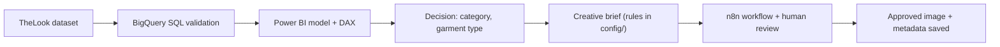
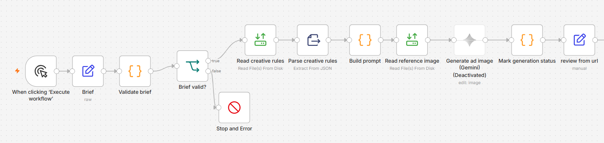
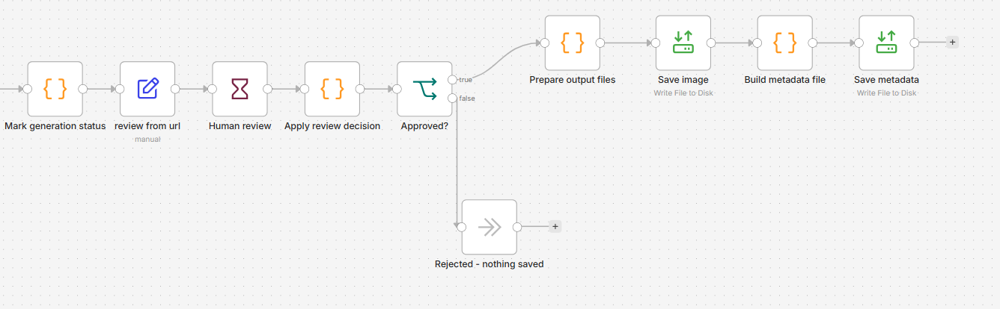

# E-commerce Marketing Decision Analytics

From sales data to a marketing decision, and from that decision to an ad-image automation with mandatory human review.

**Status:** synthetic data (TheLook eCommerce) · Stages 0–7 complete

## In Two Minutes

**Where should a growing e-commerce business with a limited marketing budget focus next?**

This project builds an end-to-end decision-support system for a **fictional** e-commerce company whose sales are growing more slowly than expected. Instead of spending more across the board, the company needs evidence on which product categories are truly profitable, which carry operational risk (returns, cancellations), and where marketing effort is most likely to pay off.

> **Data note:** the analysis uses the public [TheLook eCommerce](https://console.cloud.google.com/marketplace/product/bigquery-public-data/thelook-ecommerce) dataset on Google BigQuery, which is **synthetic**. All figures describe this dataset only, never a real company.

**The decision:** first the category to advertise (Stage 3), then the garment type inside it (Stage 4).

| Figure (synthetic data) | Value | Source |
|---|---|---|
| Dataset | TheLook eCommerce, frozen snapshot 2026-10-07 13:27:26 UTC | [Stage 3](docs/stage-03-data-model.md) |
| Recommended category | Outerwear & Coats: #1 in all three weighting scenarios (average rank 1.00, rank variation 0) | [Stage 3](docs/stage-03-data-model.md) |
| Winning garment type | Jackets: #1 in all three scenarios | [Stage 4](docs/stage-04-star-products.md) |
| Jackets: items sold (closed months) | 1,150 | [Stage 4](docs/stage-04-star-products.md) |
| Jackets: gross profit | 92,177.39 (dataset currency units), 52.75% of the category | [Stage 4](docs/stage-04-star-products.md) |
| Jackets: gross margin / return rate | 55.79% / 27.46% | [Stage 4](docs/stage-04-star-products.md) |
| Jackets: department label | predominantly men's (69.22% of items sold) | [Stage 4](docs/stage-04-star-products.md) |

**What was automated:** a creative brief (Stage 5, rules in [`config/`](config/)) feeds an n8n workflow (Stage 6) that validates the brief, builds the image prompt from the rules, waits for a human Approve/Reject decision and saves the approved image with its metadata.

**What was not done:** the Gemini image call was never executed. Stage 6 ran in dry-run mode, so the saved image is the reference photo, not a generated ad.


*Stage 3 Power BI dashboard — Executive summary page (frozen snapshot 2026-10-07; synthetic data).*

Other dashboard pages:

- [Model validation](powerbi/01-model-validation.png)
- [Category decision](powerbi/03-category-decision.png)
- [Robustness & limitations](powerbi/04-robustness-limitations.png)
- [Garment types](powerbi/05-garment-types.png)

## How It Works



## n8n Workflow (Stage 6)



Part 1: the brief is validated (an invalid brief stops the run), the creative rules are read, the prompt is built and the reference image is loaded.



Part 2: a reviewer approves or rejects through a form; only Approve saves the image and its metadata, and Reject saves nothing.

*The "Generate ad image (Gemini)" node is deactivated: the workflow runs as a dry run and no image is generated.*

## Skills Demonstrated

| Skill | Evidence |
|---|---|
| BigQuery SQL data validation | [`sql/`](sql/), [Stage 2 doc](docs/stage-02-data-preparation.md) |
| Decision analysis (Min-Max scoring, weighting scenarios, robustness) | [`sql/04_category_performance_analysis.sql`](sql/04_category_performance_analysis.sql), [Stage 4 doc](docs/stage-04-star-products.md) |
| Power BI data model and DAX | [Stage 3 doc](docs/stage-03-data-model.md), [`powerbi/`](powerbi/) |
| Python snapshot export and independent validation | [`scripts/export_snapshot.py`](scripts/export_snapshot.py), [`scripts/type_ranking_reference.py`](scripts/type_ranking_reference.py) |
| Creative-brief specification | [Stage 5 doc](docs/stage-05-creative-brief.md), [`config/creative_rules.json`](config/creative_rules.json) |
| n8n workflow design, JavaScript Code nodes, human-in-the-loop | [`n8n/stage-06-ad-image-v1-demo.json`](n8n/stage-06-ad-image-v1-demo.json), [Stage 6 doc](docs/stage-06-n8n-automation.md) |
| Documentation and Git workflow | [`docs/`](docs/) (one file per stage, with a stage log) |

## Honest Limits

- The data is synthetic (TheLook eCommerce); no figure describes a real company.
- The creative rules are assumption-based, not evidence of performance.
- No real campaign was run.
- The Gemini image call was not executed (dry run).
- The project does not publish anything or measure performance.

## Conclusion: What This Project Shows

**The question was where a limited marketing budget should go. The answer I can defend is Outerwear & Coats and, inside it, Jackets, because that result did not depend on a lucky weighting: it ranked first in all three scenarios I tested.** (All figures come from a synthetic dataset.)

But the answer is not the main thing I built. **The main thing is the method:** validate the data, rank the options under several scenarios, check that the winner is robust, turn the decision into a creative brief, and automate the content step with a person approving before anything is saved.

**A method, not a one-off.** I built the chain so that a business that sells products could reuse it. The creative layer is already driven by configuration (seasons, formats, approaches and restrictions live in `config/`), and the image provider sits in a single node. The analytical layer is reusable as a method rather than as a configurable product: the scoring weights and the data mapping are written explicitly into the SQL, Python and DAX, so adapting it means editing them, and [the Stage 7 document](docs/stage-07-portfolio-finalization.md) lists exactly where. I have run it on one dataset only; applying it to a second business is the real test.

**I stopped where the evidence stopped.** The data is synthetic, the creative rules are assumptions and no real campaign exists to measure, so the image-generation call was never executed. The step is built and documented with a checklist for the day it is justified.

**With real data** I would check whether the same ranking holds, enable generation behind a spend cap and close the loop by measuring how the approved ads perform.

**How I work, as this project shows it.** I verify before I trust: an independent Python check of the ranking, a frozen data snapshot, a validator tested with an invalid brief. I separate facts from assumptions and label which is which. And I keep a person in the loop wherever an automated step could act on its own. I come from civil engineering, where decisions are made under uncertainty and assumptions have to be written down; I tried to work the same way here.

Full detail by stage is below.

## Project Progress

| Stage | Focus | Status |
|---|---|---|
| 0 | Environment and repository setup | ✅ Completed |
| 1 | Business case and dataset selection ([docs](docs/stage-01-business-case.md)) | ✅ Completed |
| 2 | Data preparation and analytical validation in SQL / BigQuery ([docs](docs/stage-02-data-preparation.md), [SQL](sql/)) | ✅ Completed |
| 3 | Data model, DAX measures and Power BI dashboard ([docs](docs/stage-03-data-model.md)) | ✅ Completed |
| 4 | Best garment types inside the winning category (Outerwear & Coats) ([docs](docs/stage-04-star-products.md)) | ✅ Completed |
| 5 | Creative brief for the ad automation (specification only, assumption-based) ([docs](docs/stage-05-creative-brief.md)) | ✅ Completed |
| 6 | n8n automation with human review for ad-image generation (dry run; nothing is published) ([docs](docs/stage-06-n8n-automation.md), [workflow](n8n/)) | ✅ Completed (dry-run v1; real Gemini generation deferred — Gemini call not executed) |
| 7 | Portfolio finalization ([docs](docs/stage-07-portfolio-finalization.md)) | ✅ Completed |

All stages are complete. Stage 6 delivered a dry-run workflow: the image-generation call was not executed, and real generation is deferred. The project does not publish to any platform or measure performance, and a publication and feedback loop is described only as possible future work.

**Stage 2 highlights:** referential-integrity and date-consistency checks, documented revenue and COGS recognition rules by order status, monthly MoM/YoY performance, and a multi-dimensional Category Decision Model (Min-Max scoring plus sensitivity and robustness analysis).

## Technologies

- **Google BigQuery (SQL)** — data-quality validation, financial rules and the category decision model (Stage 2), snapshot export queries (Stage 3)
- **Power BI (Power Query, DAX)** — star-schema data model, decision measures and dashboard (Stages 3–4)
- **Python (pandas)** — snapshot export and verification, independent reference calculations (Stages 3–4)
- **[n8n](https://n8n.io/)** — self-hosted workflow automation with JavaScript Code nodes and a human review step (Stage 6)
- **Gemini API** — planned image provider, configured in one node but not executed (Stage 6)
- **Git / GitHub** — version control, one commit series per stage

## Folder Structure

```
.
├── workflows/               # Reserved, empty placeholders (.gitkeep only)
│   ├── 01-learning/
│   ├── 02-personal-projects/
│   └── 03-portfolio-projects/
├── docs/                    # Notes, guides, and project documentation
│   ├── stage-01-business-case.md
│   ├── stage-02-data-preparation.md
│   ├── stage-03-data-model.md
│   ├── stage-04-star-products.md
│   ├── stage-05-creative-brief.md
│   ├── stage-06-n8n-automation.md
│   └── stage-07-portfolio-finalization.md
├── config/                  # Configuration files for the ad automation (added in Stage 5)
├── n8n/                     # Sanitized n8n workflow export, no credentials (added in Stage 6)
├── sql/                     # SQL scripts (added in Stage 2 — see below)
├── data/
│   └── raw/                 # Frozen dataset snapshots (added in Stage 3 — see below)
├── scripts/                 # Python scripts (added in Stage 3 — see below)
├── powerbi/                 # Power BI dashboard screenshots (added in Stage 3);
│                            # the .pbix and .pbit stay outside the repository
├── templates/               # Reserved, empty placeholder (.gitkeep only)
├── .gitignore
└── README.md
```

### `workflows/`

Reserved, empty placeholders: `01-learning/`, `02-personal-projects/` and `03-portfolio-projects/` contain only a `.gitkeep` file. The project's real workflow export is in [`n8n/`](n8n/).

### `docs/`

Reference notes, setup guides, architecture explanations, and any written documentation that supports the workflows in this repository. This includes one documentation/log file per stage (see "Development Approach" below): `stage-01-business-case.md` (complete), `stage-02-data-preparation.md` (complete), `stage-03-data-model.md` (complete), `stage-04-star-products.md` (complete), `stage-05-creative-brief.md` (complete), `stage-06-n8n-automation.md` (complete: dry-run v1; real Gemini generation deferred), and `stage-07-portfolio-finalization.md` (complete).

### `config/`

Added in Stage 5. Configuration files for the ad automation: creative rules and an example brief.

- `creative_rules.json` — `version`, `stage` and `note`, plus `seasons`, `department_model`, `formats`, `restrictions`, `sources`, `creative_approaches`, `default_approach_by_format`, `color_harmony` and `aida_note`.
- `brief_example.json` — one example brief in demo mode.

### `n8n/`

Added in Stage 6. Holds the sanitized export of the Stage 6 workflow (`stage-06-ad-image-v1-demo.json`): no credentials, and local paths replaced by `<REPO_DIR>` and `<N8N_FILES_DIR>`. See [`docs/stage-06-n8n-automation.md`](docs/stage-06-n8n-automation.md) for how to import and run it.

### `sql/`

Added in Stage 2. Contains the project's SQL scripts — currently BigQuery SQL written against the `bigquery-public-data.thelook_ecommerce` public dataset, used for data-quality validation and analysis (Project 01, Stage 2 — Data Preparation & Analytical Validation):

- `01_data_quality_validation.sql` — referential integrity, order-item-count consistency, status/date consistency, chronological validation.
- `02_financial_validation.sql` — sale price and inventory cost validation, financial recognition rules, financial baseline.
- `03_monthly_performance_analysis.sql` — monthly financial aggregation, MoM/YoY growth, profitability trend.
- `04_category_performance_analysis.sql` — category financial/operational performance, Min-Max normalization, multi-scenario sensitivity analysis, and robustness-based category classification.

See `docs/stage-02-data-preparation.md` for the full analytical documentation and findings behind these queries.

Added in Stage 3 (frozen snapshot preparation for the Power BI data model):

- `05_snapshot_export.sql` — faithful, unjoined extracts of `order_items`, `inventory_items` (`id`, `product_id`, `cost`), `products`, and `users` (personal data excluded), all read at one instant via BigQuery time travel (`FOR SYSTEM_TIME AS OF`).
- `06_snapshot_reference.sql` — reference evidence for a snapshot: row counts plus the Stage 2 financial baseline (same rules as `02`, Section 6), `complete_items`, and `future_complete_items`, run at the same instant as the export.

### `data/`

Added in Stage 3. `data/raw/` holds frozen snapshots of TheLook eCommerce used as the Power BI data source, named `<table>_YYYY-MM-DD.csv`, plus one `manifest_YYYY-MM-DD.json` per snapshot.

- **Snapshot CSV files are not committed** (`data/raw/*.csv` is in `.gitignore`): TheLook's redistribution licensing has not been verified, and the files are large. Regenerate them with `scripts/export_snapshot.py`.
- **Category ranking references are committed** (`category_ranking_reference_YYYY-MM-DD.csv`, a `.gitignore` exception): the `sql/04` Section 8 output at the snapshot instant — per-category aggregates only, no personal data.
- **Manifests are committed** as evidence of each snapshot: snapshot instant (T), run start/end, row counts, file sizes, SHA-256 checksums, null counts, duplicate-id and orphan checks, reference KPIs, and a pandas double-check of those KPIs against the exported files.

TheLook is synthetic and dynamic: each snapshot describes one instant and is not expected to match other snapshots or earlier Stage 2 figures.

### `scripts/`

Added in Stage 3. `export_snapshot.py` runs `sql/05` and `sql/06` against BigQuery (Application Default Credentials via `gcloud auth application-default login` — no credentials are stored in this repository), writes the CSV files and manifest to `data/raw/`, and verifies them. It refuses to overwrite existing snapshot files unless `--overwrite` is passed. Run `python scripts/export_snapshot.py --help` for its commands.

### `templates/`

Reserved, empty placeholder: it contains only a `.gitkeep` file.

## Planned Architecture (Future Stages)

The structure above (Folder Structure) reflects the **current state of the repository**, including what Stages 2, 3, 4, 5 and 6 have added so far (`sql/`, `data/raw/`, `scripts/`, `powerbi/` (dashboard screenshots, added in Stage 3), `config/` (added in Stage 5), `n8n/` (added in Stage 6), and the `docs/stage-01-*.md` / `docs/stage-02-*.md` / `docs/stage-03-*.md` / `docs/stage-04-*.md` / `docs/stage-05-*.md` / `docs/stage-06-*.md` / `docs/stage-07-*.md` files). All planned stages (0–7) are complete. The folders below were part of the original plan and have **not been created**; they would be added only if a future stage needs them:

```
data/
├── synthetic/    # Data created to fill gaps in the public dataset;
│                 # always clearly documented as synthetic, never
│                 # presented as real
└── processed/    # Cleaned/transformed output derived from raw + synthetic

notebooks/        # Jupyter notebooks (Python analysis)
content/          # AI-generated content artifacts
results/          # Outputs and findings
```

None of these folders exist in the repository (`powerbi/`, originally planned here, was added in Stage 3 and is listed under Folder Structure).

## Development Approach — Stage-Based Workflow

This project is built in numbered stages (Stage 0 through Stage 7), each producing working output, documentation, and a Git commit before moving to the next stage — stages are not skipped even when a tool could technically do the work automatically.

Starting with Stage 1, each stage gets a single file at `docs/stage-XX-short-name.md` that doubles as professional project documentation and a stage log. Its sections:

- Stage Objective
- Technical Context (Business Context in Stage 1)
- Work Completed
- Decisions Made
- Concepts Learned
- Problems Encountered
- Solutions
- PL-300 Connection (when applicable)
- Skills Demonstrated
- Portfolio Evidence
- Stage Validation
- Stage Log

Not every stage uses every section: Stages 1 and 2 add stage-specific analysis sections (Stage 2 closes with "Stage 2 Checkpoint Status" instead of a Stage Log), and Stage 6 uses "Purpose and Scope" and "Verification Performed" instead of Stage Objective and Stage Validation. Sections are filled in progressively as each stage advances rather than all at once. Seven such files exist so far: `docs/stage-01-business-case.md` (Stage 1, complete), `docs/stage-02-data-preparation.md` (Stage 2, complete), `docs/stage-03-data-model.md` (Stage 3, complete), `docs/stage-04-star-products.md` (Stage 4, complete), `docs/stage-05-creative-brief.md` (Stage 5, complete), `docs/stage-06-n8n-automation.md` (Stage 6, complete: dry-run v1; real Gemini generation deferred), and `docs/stage-07-portfolio-finalization.md` (Stage 7, complete).

## ⚠️ Security: Credentials and Secrets

**Credentials, API keys, tokens, and secrets must never be committed to this repository.**

n8n workflow exports can sometimes include credential references or sensitive configuration — always review a workflow's JSON before committing it. This repository's `.gitignore` is configured to help prevent common cases (`.env` files, credential files, tokens, local n8n database/config files, logs, etc.), and also covers Python/Jupyter artifacts, Power BI local cache files and the raw snapshot CSVs — but it is not a substitute for manual review. The Stage 6 workflow export was sanitized before it was added: local paths were replaced by placeholders and it contains no credentials.

If a secret is ever accidentally committed, treat it as compromised: revoke/rotate it immediately, in addition to removing it from the repository history.

## License

The code and documentation in this repository are released under the MIT License (see [LICENSE](LICENSE)). The [TheLook eCommerce](https://console.cloud.google.com/marketplace/product/bigquery-public-data/thelook-ecommerce) dataset and any data files derived from it are not covered by this license and remain subject to the dataset provider's own terms. The redistribution terms for TheLook have not been independently verified, which is why the raw snapshot CSVs are not committed (see `data/` above).

## Pending Decisions

- **License** — resolved: the MIT License was added in Stage 7 (see "License" above).

## Status

✅ Stage 0 (Environment Setup) is complete. ✅ Stage 1 (Business Case & Data Acquisition) is complete — the primary dataset (TheLook eCommerce) was selected through a documented evaluation and gap analysis. ✅ Stage 2 (Data Preparation & Analytical Validation) is complete (closed 2026-09-21) — see `docs/stage-02-data-preparation.md` for the full validation, Category Decision Model, and SQL consolidation record. ✅ Stage 3 (Data Model & Power BI) is complete (closed 2026-10-15) — the frozen snapshot of TheLook (2026-10-07) was exported and verified (`data/raw/manifest_2026-10-07.json`), and the Power BI model, DAX measures, category decision model and four-page dashboard were built and validated — see `docs/stage-03-data-model.md`. ✅ Stage 4 (garment types inside the winning category) is complete (closed 2026-10-17) — see `docs/stage-04-star-products.md`. ✅ Stage 5 (Creative Brief) is complete (closed 2026-10-17) — see `docs/stage-05-creative-brief.md`. ✅ Stage 6 (n8n automation) is complete (closed 2026-10-19; dry-run v1, real Gemini generation deferred) — the workflow was built and verified in dry-run mode and the Gemini call was not executed — see `docs/stage-06-n8n-automation.md` and `n8n/`. ✅ Stage 7 (portfolio finalization) is complete (closed 2026-10-20) — see `docs/stage-07-portfolio-finalization.md`. Expect the structure and contents to evolve incrementally, one stage at a time, as skills and projects mature.
